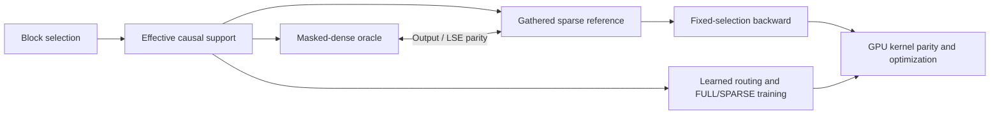

# MSA Systems Lab

**From sparse-attention semantics to GPU execution.**

A correctness-first engineering investigation of **block-sparse attention**, **learned routing**, and the gap between **reduced mathematical work** and **faster hardware execution**.

> **Release status:** The P1 correctness/GPU profiling reference, P2 routing and TinyLM training system, and **four curated engineering cases** are public. The [public CPU workflow passed 174 tests, analysis tools and train/eval/generate commands](https://github.com/yza-thu-eiri/msa-systems-lab/actions/runs/40989283570). Historical A4000 and C06/C07 experiment results remain **recorded internal observations**: the original checkpoints and replay logs have not been independently rerun from this release.
>
> **Scope:** Independent reproduction and systems analysis—not an official MiniMax implementation, a production attention library, or a claim of a new attention algorithm.

## Three questions

1. **Semantics** — Are masked-dense and gathered sparse attention computing the same function over the same causal support?
2. **Training** — What does imperfect learned block routing actually change in downstream model behavior?
3. **Execution** — When does mathematical sparsity translate into faster GPU work?

The central design decision is to keep **readable correctness oracles** separate from future high-performance execution paths.

## Selected engineering findings

### 01 · Fewer FLOPs, slower execution

A transparent gathered reference reduced main QK/PV arithmetic by **2.65×** versus a masked-dense oracle in a small RTX A4000 / FP32 test, but its complete forward callable was **1.81× slower** in a two-sample diagnostic run. Host-driven irregular work, synchronization, and thousands of tiny kernels explain the mismatch.

| Ksel=2 (B=1, N=128, Hq=8, Hkv=2, D=64) | Masked-dense | Gathered sparse |
| --- | ---: | ---: |
| QK/PV FLOPs | 33,554,432 | 12,648,448 |
| CUDA Event median (ms) | 126.732 | 229.488 |
| Profiler GPU kernel events | 2,598 | 7,189 |

**[Read Case Study 01 — Fewer FLOPs, Slower Sparse Attention](docs/case-studies/01-fewer-flops-slower-execution.md)**

Benchmark artifacts: [CUDA harness](benchmarks/reference/benchmark_forward.py) · [reproduction guide](benchmarks/README.md) · [A4000 timing CSV](evidence/p1_c05_a4000.csv) · [raw Profiler tables](evidence/profiler_tables/minimal_self_time_tables.txt).

*Measurement boundary: complete PyTorch/Python forward callables including validation and support construction, after two warmups and with only two timing samples. These are not statistically stable performance estimates, and do not measure an optimized sparse GPU kernel.*

### 02 · Routing error is not task failure

A small-model block router reached a persistent Routing-KL plateau near **0.205** in a related training investigation. A separate paired FULL/SPARSE replay showed that routing retained most teacher attention mass, with a modest average task accuracy gap—but **thousands of real prediction changes**.

| Held-out sparse-active positions | Recorded result |
| --- | ---: |
| Prediction positions audited | 83,616 |
| Teacher attention mass retained | 95.7631% |
| FULL / SPARSE top-1 accuracy | 54.988% / 54.409% |
| Top-1 prediction identity changed | 4.73% |

**[Read Case Study 02 — Routing Error Is Not the Same as Task Failure](docs/case-studies/02-routing-error-and-task-impact.md)**

*The KL plateau and paired functional audit are related but distinct experiment contexts. Conclusions are limited to controlled small-model observations, not deep-model or long-context guarantees.*

### 03 · Sparse execution can be learned around

A common-state 100-step FULL/SPARSE continuation produced a **66.46% smaller same-weight execution gap** on the SPARSE-trained branch than the FULL control branch. This was one internal tiny-model seed, not a public replay or a general convergence law.

**[Read Case Study 03 — Adapting to Sparse Execution](docs/case-studies/03-adapting-to-sparse-execution.md)**

### 04 · Does routing error cascade across layers?

In a historical 7-checkpoint × 4-batch two-layer audit, upstream switching altered only **0.228%–0.488%** of downstream support rows. At matched horizons, staged switching added **9.3% or 46.7%** logical Main attention pairs for tiny held-out NTP differences. Those are descriptive BF16 population / FP32 schedule results from different experiments, **not GPU runtime wins**.

**[Read Case Study 04 — Do Sparse Errors Cascade Across Layers?](docs/case-studies/04-do-sparse-errors-cascade-across-layers.md)**

## What is established—and what is not

| System component | Evidence maturity | Public artifact |
| --- | --- | --- |
| Causal support contract | Phase 1 internally verified; [public CPU acceptance check passed](https://github.com/yza-thu-eiri/msa-systems-lab/actions/runs/40890498194) | [Source](src/msa_lab/contracts/support.py) · [Tests](tests/test_support.py) · [Contract](docs/reference/causal-support.md) |
| Masked-dense / gathered sparse forward | Phase 1 internally verified; [43 public CPU tests passed](https://github.com/yza-thu-eiri/msa-systems-lab/actions/runs/40892058862) (support + both forward paths) | [Forward parity](docs/reference/forward-parity.md) · [Oracle](src/msa_lab/reference/masked_dense.py) · [Gathered](src/msa_lab/reference/gathered_sparse.py) · [Tests](tests/) |
| Manual fixed-selection backward | Frozen P1 reference; [51-test public suite passed](https://github.com/yza-thu-eiri/msa-systems-lab/actions/runs/40892923837) | [Gradient derivation](docs/reference/manual-backward.md) · [Source](src/msa_lab/reference/gathered_sparse_backward.py) · [Autograd tests](tests/test_gathered_sparse_backward.py) · [Finite differences](tests/test_backward_finite_difference.py) |
| P1 CUDA benchmark harness | Publicly inspectable; CPU helper tests included in the [53-test CI run](https://github.com/yza-thu-eiri/msa-systems-lab/actions/runs/40898609639) | [Harness](benchmarks/reference/benchmark_forward.py) · [Run guide](benchmarks/README.md) · [Historical evidence](evidence/p1_c05_gpu_facts.md) |
| P2 Index / BlockMax / canonical top-k | Public CPU tests passed | [Routing guide](docs/routing.md) · [Index](src/msa_lab/reference/index_blockmax.py) · [Selection](src/msa_lab/reference/selection.py) |
| P2 Routing-KL, gradient ownership, FULL/SPARSE Main | [100 public tests passed](https://github.com/yza-thu-eiri/msa-systems-lab/actions/runs/40902856254) | [MSA layer](src/msa_lab/model/msa_attention.py) · [Routing-KL](src/msa_lab/reference/routing_kl.py) · [Example](examples/routing_walkthrough.py) |
| P2 TinyLM train/eval/generate and exact resume | [164 public tests and CLI smoke passed](https://github.com/yza-thu-eiri/msa-systems-lab/actions/runs/40988032322) | [Training guide](docs/training.md) · [Engine](src/msa_lab/training/engine.py) · [CPU config](configs/p2_cpu_smoke.json) · [Resume test](tests/test_public_p2_training_resume.py) |
| P2 historical routing/switch/two-layer studies | Curated historical ledger; synthetic audit and work tools [tested in public CI](https://github.com/yza-thu-eiri/msa-systems-lab/actions/runs/40989283570); original raw runs absent | [Cases 02–04](docs/case-studies/02-routing-error-and-task-impact.md) · [Evidence boundary](docs/p2-experiment-evidence.md) · [Ledger](evidence/p2_historical_summary.json) |
| GPU-friendly Triton/kernel execution and speedup | **Not established** | Future work |
| Irregular metadata, backward scheduling, inference runtime | **Not established** | Future work |

## Runnable CPU correctness and training demos

- [P1 fixed-support walkthrough](examples/fixed_support_walkthrough.py): output/LSE parity and manual gradients.
- [P2 routing walkthrough](examples/routing_walkthrough.py): dynamic Index BlockMax, selected block IDs, effective support and Routing-KL.
- [C07 four-state walkthrough](examples/c07_four_state_walkthrough.py): synthetic same-weight FF/SF/FS/SS TinyLM execution.

Both run on CPU and demonstrate semantic correctness rather than GPU throughput. The [TinyLM CPU training smoke](docs/training.md) additionally exercises a bounded FULL→SPARSE run, checkpoint, evaluation and generation.

## How to navigate

- **Fast technical review:** [01: GPU cost paradox](docs/case-studies/01-fewer-flops-slower-execution.md) · [02: routing-to-task](docs/case-studies/02-routing-error-and-task-impact.md) · [03: sparse training adaptation](docs/case-studies/03-adapting-to-sparse-execution.md) · [04: two-layer propagation](docs/case-studies/04-do-sparse-errors-cascade-across-layers.md).
- **Evidence discipline and release queue:** [Publication and evidence standards](docs/PUBLICATION.md).
- **Correctness-first code:** Read the [causal-support contract](docs/reference/causal-support.md), [same-support forward parity](docs/reference/forward-parity.md), and [manual backward derivation](docs/reference/manual-backward.md). The public P1/P2 CPU suite [passed 174 tests](https://github.com/yza-thu-eiri/msa-systems-lab/actions/runs/40989283570), including finite differences, P2 optimizer ownership, exact resume, paired-transition audit, C07 work model, population aggregator and benchmark helper checks.
- **Run the released tests:** Use Python 3.12, install with `python -m pip install -e ".[test]"`, then `python -m pytest tests/`. For CPU-only PyTorch, see the [CI installation workflow](.github/workflows/reference-tests.yml).
- **Further reproducibility:** [P2 evidence guide](docs/p2-experiment-evidence.md) separates public analysis tools from original missing C06/C07 checkpoints, dirty-source patch and raw replay records. Synthetic CPU checks do not reproduce historical held-out results.

## Next frontier: turning sparsity into GPU work

The next work asks how to transform a semantically transparent reference into an efficient GPU execution path without silently changing its meaning: SM/warp execution, registers and memory movement, launch overhead, tiling, irregular support, physical GQA K/V reuse, precision, and forward/backward parity.

Any future speedup claim will require a specified baseline, hardware, shapes, dtype, timing methodology, correctness verification, and sampling statistics.

---

*MSA stands for MiniMax Sparse Attention. This is an unaffiliated, independent educational and engineering investigation.*

*中文简介：围绕稀疏注意力正确性、Router 的实际任务影响以及 GPU 执行效率，将经过验证的技术成果逐步整理为可审阅的工程案例。*
