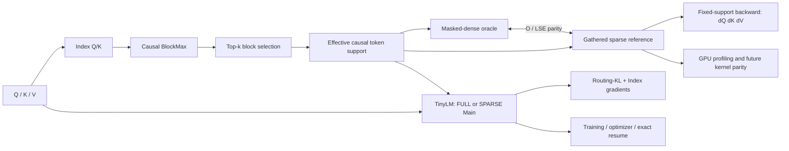

# MSA Systems Lab

**Correctness-first sparse attention: from semantic oracles and learned routing to GPU execution.**

[](https://github.com/yza-thu-eiri/msa-systems-lab/actions/workflows/reference-tests.yml)
[](LICENSE)

This is an **independent engineering investigation**, not an official MiniMax implementation or a production kernel library. It asks three questions:

1. **Correctness:** Does gathered block-sparse attention match a masked-dense oracle over exactly the same causal support, including gradients?
2. **Learning:** What do routing mistakes actually change in task loss, token correctness, and the dynamics of FULL→SPARSE training?
3. **Execution:** Why can fewer QK/PV operations still produce slower GPU execution, and what must change in a future kernel?

**Current boundary:** P1 reference forward/backward, P2 learned Router and TinyLM training, exact resume, and CPU acceptance checks are public. P3 optimized GPU kernels and distributed execution are **not yet established**. Historical A4000/C06/C07 experiment numbers remain explicitly labeled as recorded internal measurements when original raw inputs are not public.

## Four engineering findings

| Investigation | Technical finding | Evidence and limits |
| --- | --- | --- |
| **[01 · Fewer FLOPs, slower execution](docs/case-studies/01-fewer-flops-slower-execution.md)** | At a small A4000 FP32 shape, gathered sparse needed **2.65× less** Main attention arithmetic but ran **1.81× slower** than masked-dense. | [CUDA Events + Profiler](benchmarks/README.md); only two latency samples, not independently GPU-rerun |
| **[02 · Routing error vs task failure](docs/case-studies/02-routing-error-and-task-impact.md)** | In an 83,616-position paired audit, selected support retained **95.7631%** teacher mass; **4.73%** of top-1 tokens changed even though net accuracy fell **0.579 pp**. | [Historical plots and evidence ledger](docs/p2-experiment-evidence.md); original checkpoint/token CSV not public |
| **[03 · Adapting to sparse execution](docs/case-studies/03-adapting-to-sparse-execution.md)** | A same-state 100-step training fork reported a **66.46% smaller** FULL/SPARSE execution gap in SPARSE-trained weights. | One historical tiny-model seed; bounded public CPU mode-switch/resume test is separate |
| **[04 · Multi-layer propagation](docs/case-studies/04-do-sparse-errors-cascade-across-layers.md)** | In a two-layer held-out audit, upstream changes crossed only **0.228–0.488%** of downstream support rows; staged switching bought little quality for extra logical work. | Frozen 7-checkpoint × 4-batch population; [work-proxy ratios independently recomputable](scripts/analyze_c07_work_crossover.py), not GPU speedups |

> **Read the figures, not just the headline metrics.** [Case Study 02](docs/case-studies/02-routing-error-and-task-impact.md) now includes four original historical diagnostic charts: joint LM/KL divergence, fixed-batch function audit, attention-to-token effects and token correctness cohorts. Their byte-identical source hashes and limitations are indexed [here](docs/p2-experiment-evidence.md).

## Architecture and correctness boundary



- **Semantic verification:** causal support contract; masked-dense vs gathered forward/O-LSE checks; manual dQ/dK/dV with autograd and finite-difference oracles.
- **Training verification:** Index gradient ownership, FULL/SPARSE per-layer execution, shared Dense anchor, optimizer and RNG state, interrupted/resumed training equivalence.
- **Performance investigation:** CUDA Event and PyTorch Profiler are distinct measurements; the present gathered reference is deliberately readable, **not** kernel optimized.

## Run the public checks

Use **Python 3.12**. On CPU, install the matching PyTorch wheel first:

```bash
python -m pip install torch==2.11.0 --index-url https://download.pytorch.org/whl/cpu
python -m pip install -e ".[test]"
python -m pytest tests/ -ra

python examples/fixed_support_walkthrough.py
python examples/routing_walkthrough.py
python examples/c07_four_state_walkthrough.py
```

The public [GitHub Actions workflow](.github/workflows/reference-tests.yml) also trains, evaluates and generates from a bounded synthetic TinyLM checkpoint. To run it locally:

```bash
python -m msa_lab.training.cli --config configs/p2_cpu_smoke.json
python -m msa_lab.training.eval_cli --config configs/p2_cpu_smoke.json --checkpoint artifacts/p2-cpu-smoke/checkpoint_final.pt
python -m msa_lab.training.generate_cli --config configs/p2_cpu_smoke.json --checkpoint artifacts/p2-cpu-smoke/checkpoint_final.pt --prompt 0,1,2,3 --max-new-tokens 2
```

The CPU-only suite skips the separately published CUDA exact-resume regression when no GPU is available. A skipped CUDA test is **not** evidence that it passed on GPU. The synthetic training smoke proves wiring and state handling only; it does not recreate historical held-out model outcomes.

## Choose the right evidence level

| Claim or artifact | Reproducibility in this checkout |
| --- | --- |
| Support, attention parity, Routing-KL ownership, training and exact resume | **Public CPU test + runnable demo**; [test suite](tests/) and CI |
| C07 logical forward-work ratios by sequence length | **Public recomputation** using [geometry-only config](configs/c07_work_proxy.json); *not* measured latency |
| P1 A4000 CUDA timing/profiler | **Historical run + published harness/selected records**; rerun needed for a new GPU claim |
| C06/C07 Router/task, adaptation and propagation percentages | **Historical internal observation**, original checkpoints/batch audits and exact dirty-source snapshot not released |
| Production sparse CUDA/Triton speedup, deeper/longer or multi-GPU behavior | **Not established** |

Source and artifact provenance: [Publication standards](docs/PUBLICATION.md) · [P2 evidence and analysis tools](docs/p2-experiment-evidence.md).

## Navigation

- [Causal support](docs/reference/causal-support.md) · [Forward parity](docs/reference/forward-parity.md) · [Manual backward derivation](docs/reference/manual-backward.md)
- [P2 routing semantics](docs/routing.md) · [TinyLM training / exact resume guide](docs/training.md)
- [P1 GPU benchmark reproduction](benchmarks/README.md) · [P2 paired prediction auditor](scripts/audit_paired_predictions.py) · [C07 four-state population aggregation](scripts/aggregate_c07_interaction_audits.py)

**Next frontier:** build a GPU-friendly sparse execution path that reproduces the fixed-support oracle before claiming wall-clock speedups. The main engineering unknowns are launch granularity, irregular metadata, memory movement, physical GQA reuse, numeric parity and execution scheduling.

---

*MSA = MiniMax Sparse Attention. This repository is an unaffiliated educational and engineering investigation. Licensed under MIT.*
