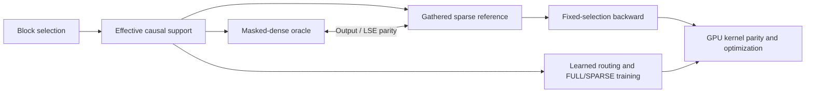

# MSA Systems Lab

**From sparse-attention semantics to GPU execution.**

A correctness-first engineering investigation of **block-sparse attention**, **learned routing**, and the gap between **reduced mathematical work** and **faster hardware execution**.

> **Release status:** The first two technical case studies and the P1 forward/backward correctness references and tests are public. The public CPU acceptance suite passed **51 tests**. The P1 benchmark harness and selected historical GPU evidence are now public; those historical measurements have not yet been independently re-run from this release. P2 training artifacts remain pending.
>
> **Scope:** Independent reproduction and systems analysis—not an official MiniMax implementation, a production attention library, or a claim of a new attention algorithm.

## Three questions

1. **Semantics** — Are masked-dense and gathered sparse attention computing the same function over the same causal support?
2. **Training** — What does imperfect learned block routing actually change in downstream model behavior?
3. **Execution** — When does mathematical sparsity translate into faster GPU work?

The central design decision is to keep **readable correctness oracles** separate from future high-performance execution paths.

## Selected engineering findings

### 01 · Fewer FLOPs, slower execution

A transparent gathered reference reduced main QK/PV arithmetic by **2.65×** versus a masked-dense oracle in a small RTX A4000 / FP32 test, but its complete forward callable was **1.81× slower** in a two-sample diagnostic run. Host-driven irregular work, synchronization, and thousands of tiny kernels explain the mismatch.

| Ksel=2 (B=1, N=128, Hq=8, Hkv=2, D=64) | Masked-dense | Gathered sparse |
| --- | ---: | ---: |
| QK/PV FLOPs | 33,554,432 | 12,648,448 |
| CUDA Event median (ms) | 126.732 | 229.488 |
| Profiler GPU kernel events | 2,598 | 7,189 |

**[Read Case Study 01 — Fewer FLOPs, Slower Sparse Attention](docs/case-studies/01-fewer-flops-slower-execution.md)**

*Measurement boundary: complete PyTorch/Python forward callables including validation and support construction, after two warmups and with only two timing samples. These are not statistically stable performance estimates, and do not measure an optimized sparse GPU kernel.*

### 02 · Routing error is not task failure

A small-model block router reached a persistent Routing-KL plateau near **0.205** in a related training investigation. A separate paired FULL/SPARSE replay showed that routing retained most teacher attention mass, with a modest average task accuracy gap—but **thousands of real prediction changes**.

| Held-out sparse-active positions | Recorded result |
| --- | ---: |
| Prediction positions audited | 83,616 |
| Teacher attention mass retained | 95.7631% |
| FULL / SPARSE top-1 accuracy | 54.988% / 54.409% |
| Top-1 prediction identity changed | 4.73% |

**[Read Case Study 02 — Routing Error Is Not the Same as Task Failure](docs/case-studies/02-routing-error-and-task-impact.md)**

*The KL plateau and paired functional audit are related but distinct experiment contexts. Conclusions are limited to controlled small-model observations, not deep-model or long-context guarantees.*

## What is established—and what is not

| System component | Evidence maturity | Public artifact |
| --- | --- | --- |
| Causal support contract | Phase 1 internally verified; [public CPU acceptance check passed](https://github.com/yza-thu-eiri/msa-systems-lab/actions/runs/40890498194) | [Source](src/msa_lab/contracts/support.py) · [Tests](tests/test_support.py) · [Contract](docs/reference/causal-support.md) |
| Masked-dense / gathered sparse forward | Phase 1 internally verified; [43 public CPU tests passed](https://github.com/yza-thu-eiri/msa-systems-lab/actions/runs/40892058862) (support + both forward paths) | [Forward parity](docs/reference/forward-parity.md) · [Oracle](src/msa_lab/reference/masked_dense.py) · [Gathered](src/msa_lab/reference/gathered_sparse.py) · [Tests](tests/) |
| Manual fixed-selection backward | Frozen P1 reference; [51-test public suite passed](https://github.com/yza-thu-eiri/msa-systems-lab/actions/runs/40892923837) | [Gradient derivation](docs/reference/manual-backward.md) · [Source](src/msa_lab/reference/gathered_sparse_backward.py) · [Autograd tests](tests/test_gathered_sparse_backward.py) · [Finite differences](tests/test_backward_finite_difference.py) |
| Learned routing, mode switching, exact resume, one-/two-layer diagnosis | Phase 2 internally verified; 77 regression tests recorded | Case Study 02; source/configs pending |
| GPU-friendly Triton/kernel execution and speedup | **Not established** | Future work |
| Irregular metadata, backward scheduling, inference runtime | **Not established** | Future work |

## One-command correctness demo

Run `python examples/fixed_support_walkthrough.py` after installing the package to see causal supports, forward O/LSE parity, and manual backward gradient errors. [View the example](examples/fixed_support_walkthrough.py). This is a CPU correctness check, not a benchmark.

## How to navigate

- **Fast technical review:** Start with [Case Study 01](docs/case-studies/01-fewer-flops-slower-execution.md) and [Case Study 02](docs/case-studies/02-routing-error-and-task-impact.md).
- **Evidence discipline and release queue:** [Publication and evidence standards](docs/PUBLICATION.md).
- **Correctness-first code:** Read the [causal-support contract](docs/reference/causal-support.md), [same-support forward parity](docs/reference/forward-parity.md), and [manual backward derivation](docs/reference/manual-backward.md). The full public CPU correctness suite [passed 51 tests](https://github.com/yza-thu-eiri/msa-systems-lab/actions/runs/40892923837), including a finite-difference gradient check.
- **Run the released tests:** Use Python 3.12, install with `python -m pip install -e ".[test]"`, then `python -m pytest tests/`. For CPU-only PyTorch, see the [CI installation workflow](.github/workflows/reference-tests.yml).
- **Further reproducibility:** GPU benchmark harnesses, P2 training scripts and selected raw experimental artifacts remain separate review/release tasks. Their claims retain the recorded-internal-evidence label.

## Next frontier: turning sparsity into GPU work

The next work asks how to transform a semantically transparent reference into an efficient GPU execution path without silently changing its meaning: SM/warp execution, registers and memory movement, launch overhead, tiling, irregular support, physical GQA K/V reuse, precision, and forward/backward parity.

Any future speedup claim will require a specified baseline, hardware, shapes, dtype, timing methodology, correctness verification, and sampling statistics.

---

*MSA stands for MiniMax Sparse Attention. This is an unaffiliated, independent educational and engineering investigation.*

*中文简介：围绕稀疏注意力正确性、Router 的实际任务影响以及 GPU 执行效率，将经过验证的技术成果逐步整理为可审阅的工程案例。*
