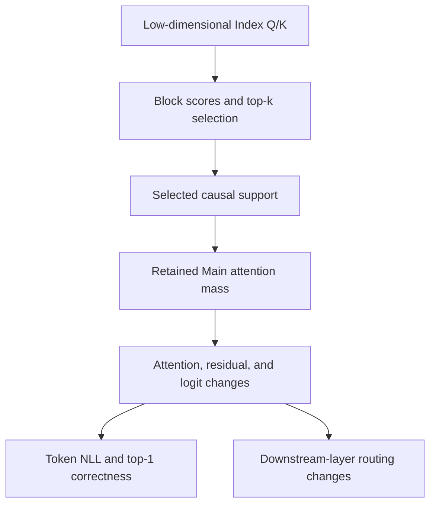
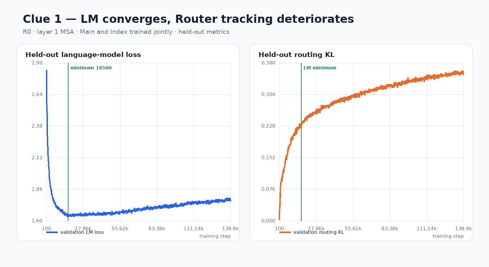
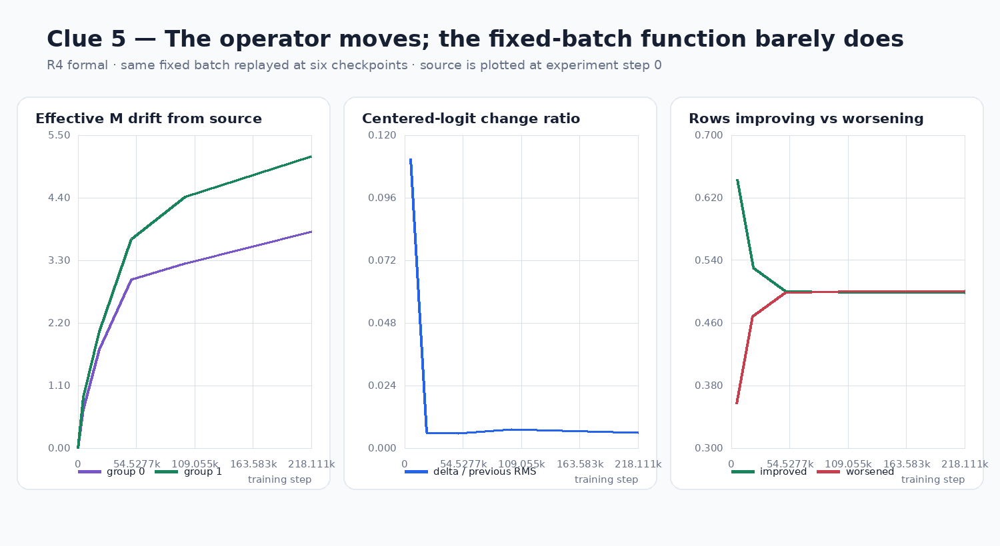
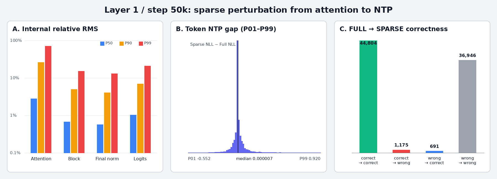
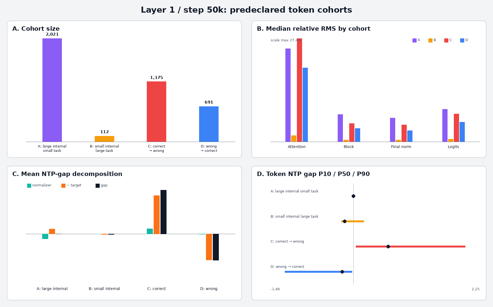

# Case Study 02 — Routing Error Is Not the Same as Task Failure

> **Question:** A low-dimensional block router reaches a nonzero Routing-KL plateau. Does that mean sparse attention fails at the language-model task?
>
> **Status:** Interpretation of recorded internal small-model experiments. The public Router/Training code and synthetic CPU tests are available, but the original historical token-level audit and training checkpoints are **not public**. These observations remain recorded internal small-model results, not independently reproduced GPU or long-context validation.

## 1. Trace consequences across system layers

**FULL** executes Main attention over the full causal history. **SPARSE** executes over the selected support. Routing-KL compares router and teacher block distributions; it does not directly measure final token loss.

These measurements answer different questions:

| Observable | Question answered | Cannot determine alone |
| --- | --- | --- |
| Routing-KL | How well does the Index distribution match its teacher? | Whether next-token predictions remain correct |
| Support coverage | How much teacher attention mass is selected? | Whether omitted values matter for target logits |
| Logit / residual delta | How far do continuous representations move? | Whether a low-margin argmax flips |
| Token NLL and correctness | What happened to the task? | Which upstream component caused it |
| Layer-to-layer support changes | Is routing affected downstream? | Deep-model stability from a two-layer test |

## 2. The KL plateau was investigated rather than assumed

*Historical C06 figure 01. The left plot tracks held-out language-model loss; the right tracks held-out Routing-KL. The underlying training logs have not been republished or rerun here.*

The routing objective in a controlled fixed-32-target experiment stabilized near **0.205**, without going to zero. Investigations separated several possible explanations:

| Controlled check | Recorded observation | Interpretation |
| --- | --- | --- |
| Gradient / optimizer ownership | Index parameters received gradients and changed; frozen Main remained exactly unchanged | Not a missing-update wiring bug |
| Freeze Main as teacher | Held-out KL still plateaued | A moving teacher was not the sole explanation |
| Repeated fixed batch | Training KL moved and train/held-out diverged | The router had some local fitting capacity |
| Change learning rate, batch, initialization, and fixed-weight FP32 Index replay | No decisive disappearance of the full-pool plateau | Not explained by a simple single-setting fix |

*Historical C06 figure 05. Parameter/operator changes continue even while the aggregate fixed-batch function barely changes; improvements and degradations across rows can cancel. This is diagnostic evidence, not a unique proof of Index-dimension capacity limits.*

The resulting **hypothesis** is a constraint of the shared low-dimensional mapping / teacher / objective combination. **It has not been shown** that Index dimension 16 alone causes the limit. The KL plateau and the downstream population audit are related but distinct experimental contexts and should not be treated as a single experiment.

## 3. Paired FULL/SPARSE replay: what actually changed?

One held-out audit of **83,616 sparse-active prediction positions** reported:

| Observation | Recorded value |
| --- | ---: |
| Coverage of FULL attention probability mass | **95.7631%** |
| FULL top-1 accuracy | 54.988% |
| SPARSE top-1 accuracy | 54.409% |
| Net accuracy gap | **−0.579 percentage points** |
| Changed top-1 prediction identity | **3,951 / 83,616 = 4.73%** |

*Historical C06 figure 06. Internal relative RMS, token NTP deltas and correctness are different measurements; the chart is not a new public model replay.*

The 3,951 changed predictions comprise three different outcomes:

| FULL → SPARSE | Positions |
| --- | ---: |
| Correct → wrong | 1,175 |
| Wrong → correct | 691 |
| One wrong token → another wrong token | 2,085 |

*Historical C06 figure 07. Token cohorts separate continuous probability effects from correct→wrong and wrong→correct prediction transitions; values originate in the same unpublished paired audit.*

That leaves a net loss of 484 correct predictions. Thus, **4.73% of predictions changed** while net accuracy moved by only **0.579 percentage points**.

The correct conclusion is not “routing errors have no effect.” Rather, average task deterioration and the distribution of token-level changes need separate reporting. Probability mass alone also ignores value direction, residual transformations, the LM head, and the target token.

## 4. A plausible safeguard that cost more than it helped

At the start of a new block, the local block has fewer causally visible tokens, which can lead to a recency-selection bias. Forcing this local block into top-k seems protective, but it uses a limited selection slot.

For one fixed single-layer checkpoint with block size 16 and top-k=2:

| Support policy | Coverage | Token NLL |
| --- | ---: | ---: |
| Forced-local | 0.957631 | 1.656358 |
| Unforced top-2 | **0.961279** | **1.653112** |

In this specific counterfactual, unforced selection performed better on both metrics. That does **not** prove locality is unimportant or that unforced selection generalizes to other budgets, contexts, or model states.

## 5. Does training adapt to switching execution?

A controlled 100-step single-seed fork from shared training state compared FULL control and SPARSE training branches. At the endpoint, the same-weight FULL-vs-SPARSE execution gap was:

| Endpoint weights trained under | FULL execution NTP | SPARSE execution NTP | Gap |
| --- | ---: | ---: | ---: |
| FULL control | 1.645637 | 1.659541 | +0.013903 |
| SPARSE branch | 1.640796 | 1.645459 | +0.004663 |

The execution gap under the SPARSE-trained weights was **66.46% smaller** than under FULL control weights. This is evidence of short-horizon adaptation, *not* a universal convergence or long-training guarantee.

A subsequent two-layer comparison tested FF (FULL/FULL), SF, FS, and SS (SPARSE/SPARSE), including simultaneous and staged mode switches. Within the studied horizon, staged switches paid additional Main attention arithmetic without a material endpoint-quality improvement relative to simultaneous switching.

A separate **7-checkpoint × 4-held-out-batch** frozen population audit found only **0.228%–0.488%** downstream support changed-row rates from upstream layer interventions. This is a cross-sectional snapshot, not a multi-seed, long-context, or deep-network guarantee.

## 6. Decisions and boundaries

1. Do not replace task-quality inspection with a routing KL threshold.
2. Distinguish **ranking error**, **fixed support budget**, and **task impact**.
3. Use paired SAME-WEIGHT execution and controlled training-state forks for different causal questions.
4. Keep continuous logit/NLL changes separate from low-margin discrete top-1 flips, particularly under BF16.
5. Defer stronger depth/length/generalization claims until corresponding studies and efficient execution exist.

**Established in these recorded experiments:** correct routing/optimizer ownership; a nontrivial KL plateau; high average selected-mass coverage; small net accuracy change but real token-level flips; no demonstrated need for staged switching in the limited two-layer setup.

**Not established:** a unique explanation for KL saturation, universal relationships among KL/coverage/task loss, stable deep or long-context routing, a competitive sparse GPU kernel, or a production speedup.

## 7. Public analysis tools and provenance

The four historical charts above were transferred as byte-identical image blobs from the private P2 review (original chart filenames 01/05/06/07). They carry **historical-source** status, not independent verification; see the image-source index in the [P2 evidence guide](../p2-experiment-evidence.md).

The public [historical summary ledger](../../evidence/p2_historical_summary.json) records the distinct experimental contexts, exact reported values, source-document Git blob identities, and SHA-256 identifiers for selected **local** artifacts. It is a curated *transcription* from the closed private Phase 2 review, not raw model output.

The generic [paired prediction auditor](../../scripts/audit_paired_predictions.py) computes correct→wrong, wrong→correct and wrong→wrong transitions from a reader-supplied CSV with columns `full_prediction,sparse_prediction,target_token`. [Synthetic acceptance tests](../../tests/test_p2_historical_evidence_audit.py) check the transition arithmetic. Neither the utility nor the ledger can replace the missing 83,616-row original CSV.

**Reproduction status:** The public [TinyLM training engine](../training.md), Router/Selection reference and tests are available and CI-verified. The original C06 checkpoint, per-token audit CSV and full run manifests are still absent. The historical run's base Git commit was recorded but the full dirty-worktree patch was not preserved, so exact source reconstruction from that commit alone is not justified. Historical numerical claims must remain at the *recorded internal observation* evidence level.

Follow-on investigations: [Sparse switch adaptation](03-adapting-to-sparse-execution.md) and [two-layer support propagation](04-do-sparse-errors-cascade-across-layers.md).
