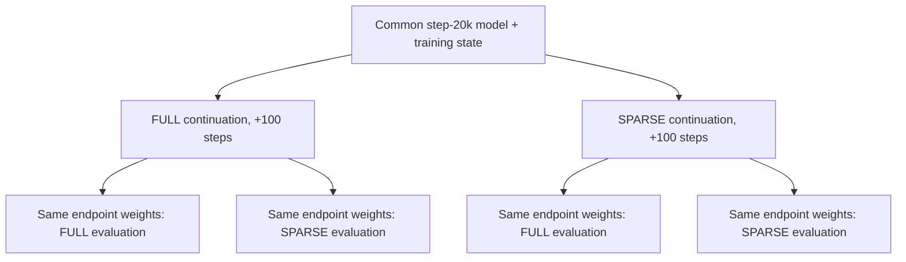

# Case Study 03 — Can a Language Model Adapt to Sparse Execution?

> **Question:** A frozen checkpoint incurs a FULL-versus-SPARSE execution penalty. Does actually *training* under sparse execution absorb that penalty?
>
> **Evidence status:** Historical internal C06-D single-seed, 100-step experiment. The public [training system](../training.md) can run a tiny synthetic FULL→SPARSE sequence, but it does **not** reproduce the original checkpoint, corpus, or figures. Historical measurements are transcribed in the [provenance-labeled ledger](../../evidence/p2_historical_summary.json).

## The experiment, not just a mode toggle

A same-weight FULL/SPARSE comparison answers how much inference quality changes **without updating parameters**. A mode-switched training fork answers a different question: can model parameters adapt while retaining the same training objective?

The C06-D intervention started from the **same step-20,000 checkpoint and training state** and forked two 100-step continuations:

1. **FULL control:** train while Main attention uses full causal history.
2. **SPARSE branch:** train while Main uses the selected sparse support.

Both branches were then evaluated in **both** execution modes on their respective endpoint weights, so evaluation mode and training history were independently varied. This separates the effect of a support approximation from the effect of learning to compensate for it.



## Historical paired endpoint evidence

| Endpoint training history | FULL execution NTP | SPARSE execution NTP | SPARSE − FULL |
| --- | ---: | ---: | ---: |
| FULL control | 1.645637 | 1.659541 | +0.013903 (recorded) |
| SPARSE continuation | 1.640796 | 1.645459 | +0.004663 |

The source reports an **approximately 66.46% reduction** in same-weight execution gap. Displayed NTP values and the first recorded gap use different rounding precision, so recomputing from the six-decimal loss cells can differ by the last decimal place.

**Interpretation:** this small model was not merely insensitive to sparse execution; updating its weights under SPARSE reduced the paired penalty substantially. The result is more informative than a single end-of-run SPARSE loss.

## The feared support-feedback failure

Because Index projection receives representations affected by Main execution, the concern was a cycle:

```text
SPARSE execution → changed hidden state → changed Router scores
                 → different top-k support → another hidden-state change
```

The historical five-step support trajectory distinguished:

- **Drift:** how far selected support moved from the initial checkpoint
- **Transition:** how often support changed between consecutive observations
- **A→B→A (ABA):** strict reversion across consecutive observations

SPARSE-trained support drifted farther from the starting selection but had **fewer consecutive changes and strict ABA reversions** than the FULL control in the recorded trajectory. Greater drift alone therefore did not imply oscillatory instability.

No full per-step support series is supplied in the public repository, so this is a documented historical observation, not a graph independently recreated from public data.

## Engineering consequence

For this tiny, single-layer, single-seed +100-step intervention, the feared blocking pathology did not appear. That made it reasonable to continue to a two-layer study rather than demand an arbitrarily low Routing-KL threshold.

This does **not** show long-run convergence, eliminate low-margin discrete routing flips, or prove that SPARSE always trains better than FULL. In particular, the 100-step endpoint cannot replace a longer matched trajectory and multi-seed variability study.

## Inspectability and reproduction limits

- [Public TinyLM training and exact-resume implementation](../training.md): the train/eval/generate code and deterministic tiny CPU check
- [Main execution mode policy](../../src/msa_lab/training/mode.py): how FULL/SPARSE mode is chosen by global step
- [Checkpoint contract](../../src/msa_lab/training/checkpoint.py): the model, optimizer, scheduler, RNG and data state required for fair forks
- [Historical evidence ledger](../../evidence/p2_historical_summary.json): recorded endpoints and source identity
- [Next case: two-layer interactions](04-do-sparse-errors-cascade-across-layers.md)

**Outstanding gap:** the original C06 training checkpoint, raw paired replay JSON, support trajectory and source dirty patch are not included. Their recorded local provenance does not make this experiment independently reproducible from the public checkout. The general public training system demonstrates the technique, not the numerical historical result.
