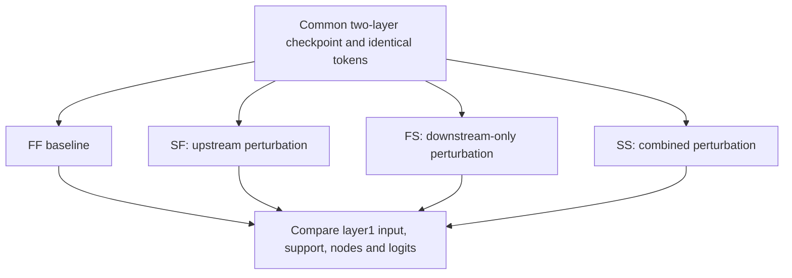

# Case Study 04 — Do Sparse-Attention Errors Cascade Across Layers?

> **Question:** If an upstream layer switches from FULL to SPARSE, does its representation error cross a downstream Router's discrete top-k boundary, producing cascading support changes? Does switching layers one at a time justify extra computation?
>
> **Status:** Curated account of the private C07 two-layer study. The [historical summary ledger](../../evidence/p2_historical_summary.json) preserves values and provenance but **not** raw per-batch replays or weights. These are not new public GPU benchmark runs.

## 1. Four execution states isolate two interventions

C06 studied sparse execution at the last Transformer layer; it could not observe an upstream approximation changing the input distribution of another Router. C07 used a two-layer TinyLM in which both layers have FULL/SPARSE Main execution.

| State | Layer 0 | Layer 1 | Question |
| --- | --- | --- | --- |
| FF | FULL | FULL | Common reference |
| SF | SPARSE | FULL | What changes solely because layer 0 switched? |
| FS | FULL | SPARSE | What does layer 1 switching do on its original input? |
| SS | SPARSE | SPARSE | What happens when both changes coexist? |

For the same checkpoint and token input, let the task-facing representation or logit output be `Y(mode)`. The **four-state interaction** is

```text
I = Y(SS) - Y(SF) - Y(FS) + Y(FF).
```

If the two perturbations were strictly additive on the chosen output, `I=0`. A nonzero interaction measures non-additivity, not necessarily worse task quality.



## 2. Separate continuous propagation from discrete support changes

**Single-probe mechanism (CPU FP32, batch size 1).** Switching layer 0 produced a layer-1-input RMS delta of `0.215908`. Its layer-1 block-output delta reached `1.898×` the input delta but the centered-logit delta contracted to `0.773×` the input delta. This probe's layer-1 support change rate was **zero**, with token Jaccard **1.0**.

Thus some intermediate tensor changes grew before the task-facing logits contracted; the discrete Router support never crossed a top-k boundary **in this one probe**. It is not a population guarantee.

**Frozen held-out population (CUDA BF16).** The later audit sampled **7 checkpoints × 4 held-out batches**, with **3,072 sparse-active prediction positions per checkpoint**. For the upstream FF→SF intervention:

| Statistic (range of checkpoint summaries) | Historical value |
| --- | ---: |
| Downstream layer-1 support changed-row rate | 0.228%–0.488% |
| Mean token support Jaccard | 0.99597–0.99822 |
| Centered-logit four-state interaction / FF RMS | 1.068%–1.454% |
| Mean loss interaction `SS−SF−FS+FF` | −0.001164 to +0.000107 |

Top-1 identity still changed under the same-weight interventions:

| Contrast against FF | Historical top-1 changed-rate range |
| --- | ---: |
| SF | 1.986%–2.507% |
| FS | 2.767%–4.655% |
| SS | 3.678%–5.176% |

Low support change rates do not imply *no* task-facing differences. The evidence instead suggests that, in this two-layer setting, many continuous perturbations **did not** cause a large downstream support cascade. The residual non-additivity was small relative to the overall FF signal under the reported metric.

The checkpoints are not independent training seeds; all 28 batches were replay observations over a limited trajectory. These ranges are descriptive, not confidence intervals.

## 3. Switching schedule is a compute-to-quality problem

A different C07 intervention began from a **common dual-FF anchor** and compared:

- `FF→FF` (control)
- `FF→SS` (simultaneous switch)
- `FF→SF→SS` (upstream first)
- `FF→FS→SS` (downstream first)

A staged schedule intentionally waits before switching the second layer. That may soften its instantaneous transition but spends more training steps computing one FULL layer. The historical staged switch points were informed by preliminary pilot trajectories: this is an **offline, hindsight-assisted comparison**, not a validated online controller.

The final evaluations below are **FP32 held-out**, each against simultaneous SS at the *same specified horizon*:

| Staged path | Horizon | Held-out NTP gap vs simultaneous SS | Main attention pair work ratio | Forward-only work proxy ratio |
| --- | ---: | ---: | ---: | ---: |
| SF→SS | Step 20,100 | −0.00043318 | 1.09333× | 1.00631× |
| FS→SS | Step 20,200 | −0.00016937 | 1.46667× | 1.03155× |

Negative gaps favor the staged path, but the gains are tiny and each schedule has a **different horizon**. At the same time, the staged paths used about **9.3%** and **46.7%** more logical Main attention pairs, respectively, than their matched synchronous baselines.

At those two endpoints, same-weight SS-trained accuracy gaps between SS and FF execution were reported as **+0.065 / −0.065 percentage points**. Small changes also depend on precision: the historical training-engine validation used FP32 whereas the standalone evaluator used BF16; those readouts must not be pooled when ranking schedules.

**Decision within this two-layer study:** prefer simultaneous switching as the simpler compute-to-quality default. The staged transitions did not show a material enough endpoint benefit to justify their extra work. That is an engineering decision conditional on the tested model and time horizon, not a theorem that staged switching is never useful.

## 4. Logical savings are not current GPU speedup

Under the recorded two-layer configuration (`N=128`, `d_model=128`, `d_ff=256`, Index dimension 16, block size 16, `top_k=2`), the SS/FF ratio for *Main QK/AV pairs alone* was **34.88%**, but the broader forward-only arithmetic proxy, which also includes projections, FFN, LM head and Router, gave:

| Sequence length | SS/FF forward-work proxy |
| --- | ---: |
| 128 | 0.9812 |
| 512 | 0.7552 |
| 2048 | 0.4304 |

These are model-based **logical work estimates**, not measured time, bandwidth, utilization or runtime speedups. The current host-driven sparse reference is slower than the dense GPU baseline at the previously tested small shape; see [Case Study 01](01-fewer-flops-slower-execution.md).

## 5. What's established and what's not

**Evidence supports:** small population-level downstream support changes for these frozen checkpoints; modest four-state non-additive interaction; real but bidirectional top-1 flips; a limited advantage of synchronous over staged switching on the observed work/quality tradeoff.

**Not established:** deeper-layer propagation, longer contexts, extra seeds, train/held-out recovery curves sampled at matched cadence, BF16-vs-FP32 equivalence, or mature sparse GPU speedup.

## Evidence & handoff

The public [two-layer TinyLM](../../src/msa_lab/model/tiny_lm.py), [per-layer mode contract](../../src/msa_lab/training/mode.py), [test coverage](../../tests/test_msa_tiny_lm_training.py) and [Exact Resume](../../tests/test_msa_exact_resume.py) substantiate the **mechanics**, not the historical C07 metrics. The latter were recorded in a private P2 review and are indexed by hashes in [`p2_historical_summary.json`](../../evidence/p2_historical_summary.json).

The underlying historical replay summaries and common-anchor checkpoint were recorded as local artifacts; they have not been published. The historical runs' base commit also does not alone reconstruct the exact source because the worktree contained an unsaved patch. Accordingly this document is an **inspectable analysis of a recorded experiment**, not an independent reproduction from public artifacts.

Next question: can a GPU-friendly sparse backend retain these same-weight O/LSE/task effects while avoiding host-driven irregular execution?
