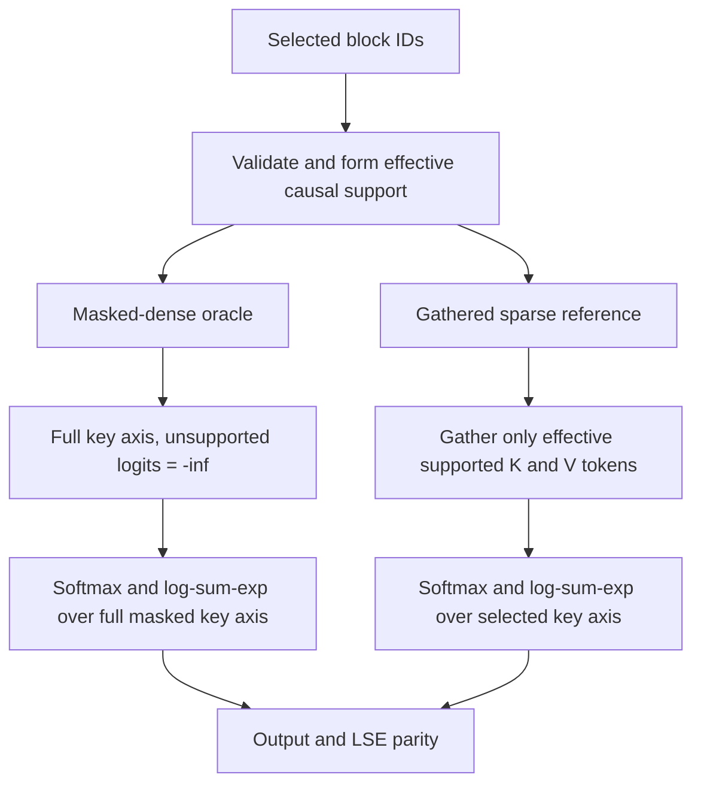

# Forward parity: one causal support, two independent execution paths

The central Phase 1 correctness question is:

> Given the *same* selected block IDs and *same* effective causal token support, do a masked-dense GQA oracle and a gathered sparse GQA reference produce equivalent attention **output** and **log-sum-exp**?

This page documents the public correctness baseline. It is **not** a GPU performance claim.

## Tensor and semantic contract

| Name | Shape | Meaning |
| --- | --- | --- |
| Q | `[B, N, Hq, D]` | Query heads |
| K, V | `[B, N, Hkv, D]` | Shared KV heads |
| G | `Hq // Hkv` | Query heads per KV head |
| block_ids | `[B, N, Hkv, Ksel]` | Raw selected block IDs, with tail `-1` padding |
| effective support | `[B, N, Hkv, N]` | Selected, in-range, causal-visible key tokens |
| O | `[B, N, Hq, D]` | Attention output |
| LSE | `[B, N, Hq]` | Natural log of the score normalization constant |

A selected block that contains only future keys may be present in raw metadata but contributes nothing to effective support. Every row must retain at least one causal-visible key.

## How the two paths differ



**Masked-dense:** Form full query–key scores, apply the selected-support mask, normalize and aggregate values. It intentionally pays the cost of full score storage/computation to serve as an independent semantic oracle.

**Gathered sparse:** For a fixed `[batch, query, KV-head]` row, gather `M` visible K/V tokens, use the `G` associated query heads, and calculate:

```text
Q row     [G, D]
K, V      [M, D]
S = Q K^T / sqrt(D)    [G, M]
P = softmax(S, -1)     [G, M]
LSE = logsumexp(S, -1) [G]
O = P V                [G, D]
```

The variable-length `M` axis is not a globally allocated `N` key axis. It is also not a performance-optimized packed representation: the current implementation uses deliberately transparent Python row loops.

The two paths share the validated **support semantics**, not the score/softmax implementation. The gathered reference does **not** call the masked-dense oracle to compute its output.

## Public source and tests

| Responsibility | Public artifact | Frozen source blob |
| --- | --- | --- |
| Raw IDs → causal support | [`contracts/support.py`](../../src/msa_lab/contracts/support.py) | `f9fb3cc150d6d2787c23a28eaed8058f6cd67f4d` |
| Masked-dense semantic oracle | [`reference/masked_dense.py`](../../src/msa_lab/reference/masked_dense.py) | `9e78366bae2317b1b4db5f7e444f8d08573684e1` |
| Gathered sparse forward | [`reference/gathered_sparse.py`](../../src/msa_lab/reference/gathered_sparse.py) | `a254b9dee599d931627c27ac29a86733d3ecfab3` |
| Full-causal dense SDPA comparator | [`backends/dense_sdpa.py`](../../src/msa_lab/backends/dense_sdpa.py) | Baseline utility; not the sparse oracle |

The three frozen semantic implementations are copied unchanged from the author's original Phase 1 work. The public `AttentionOutput` envelope is a small dependency adapter; it does not alter the frozen forward implementations.

### Verification cases

- [Masked-dense acceptance tests](../../tests/test_masked_dense.py): full-support comparison to causal SDPA, independent hand-written GQA oracle, unselected-K/V invariance, per-group support, metadata rejection.
- [Gathered acceptance tests](../../tests/test_gathered_sparse.py): masked/gathered O+LSE parity, asymmetric group supports, block-size-one and one-token special cases, selection-order invariance, empty/invalid support rejection.
- [Causal-support tests](../../tests/test_support.py): source-of-truth mask semantics.

Run the released CPU test suite (Python 3.12):

```bash
python -m pip install -e ".[test]"
python -m pytest -q tests/
```

The [public GitHub Actions workflow](../../.github/workflows/reference-tests.yml) uses a CPU build of PyTorch 2.11.0 and runs the same suite. A completed [public forward-reference run](https://github.com/yza-thu-eiri/msa-systems-lab/actions/runs/40892058862) reported **43 passed** across the released support, masked-dense and gathered-sparse tests. Manual fixed-selection backward has since been released and [tested separately](manual-backward.md); this original forward-only run does not validate benchmark results. Subsequent source changes must be judged against their own CI run.

## What forward parity does and does not prove

**It checks:** causal support, GQA head mapping, attention outputs, LSE, and the specified small-input error conditions.

**The forward-parity checks alone do not check:** gradient correctness (see [the separately published backward analysis](manual-backward.md)), production-style metadata scheduling, kernel fusion, large-sequence execution, low-precision stability, exact determinism across GPU hardware, or faster inference.

The follow-on engineering question is not to make this oracle fast; it is how to produce a separate GPU-friendly execution path whose numerical results remain accountable to this reference.
